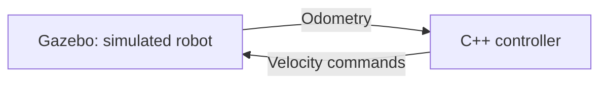

# Mobile Robot Control and Simulation

A learning project to develop and test control software for a simulated
differential-drive mobile robot.

The initial platform is a TurtleBot3 Waffle simulated in Gazebo Harmonic
with ROS 2 Jazzy. The project will use C++ and Python, with automated
testing, GitHub Actions and Docker. A Raspberry Pi may later run the
controller while the robot remains simulated.

## Initial goals

- Launch and manually control the simulated robot.
- Develop a C++ controller that drives the robot towards a target.
- Test the controller locally and with GitHub Actions.
- Use Python to analyse and plot robot behaviour.
- Add a small API for goals and status.
- Deploy the controller to a Raspberry Pi.

## Planned data flow

## Current status

- Ubuntu 24.04 and ROS 2 Jazzy are available.
- TurtleBot3 Waffle launches in an empty Gazebo world.
- The project workspace and local Git repository have been created.
